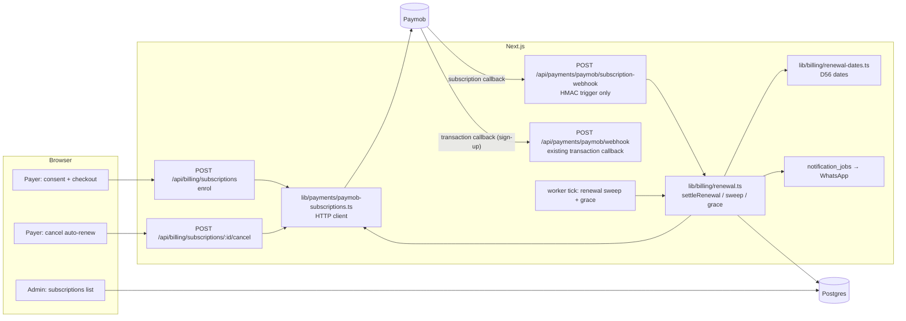
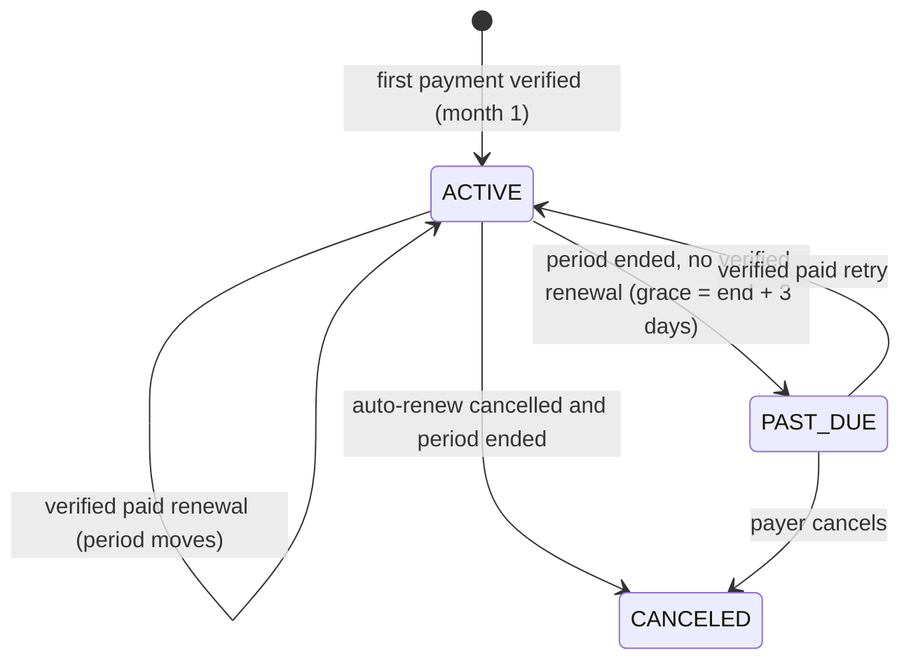
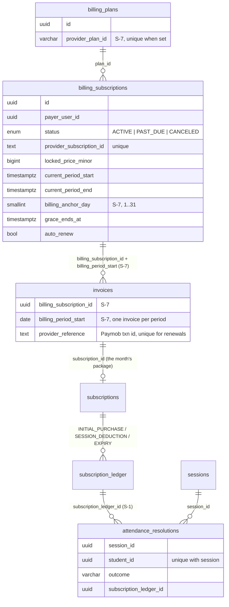

# S-RENEW — Automatic monthly renewal on Paymob subscriptions (MOTO)

> Decisions: D44, D50–D59. Research: `docs/specs/paymob-subscription-research.md`.
> Skills: engineering:system-design (this doc), superpowers:test-driven-development,
> superpowers:verification-before-completion, security-review (OWASP pass).

## 1. Requirements

**Functional**
- A payer (guardian, or an adult student without a guardian) opts in to automatic renewal for a **monthly** plan (D53) and gives consent (timestamp stored).
- The sign-up payment buys month 1 (D55, `use_transaction_amount = true`). Every renewal charges the same locked amount.
- Renewals fall on the same day of the month as the first payment. A missing day moves to the month's last day (D56). Paymob bills only in fixed day counts (`frequency 30`), so after each paid renewal the platform sets Paymob's `next_billing` to the next such date.
- A renewal moves money in our books **only after the platform re-fetches the transaction from Paymob** (the subscription callback signs only the trigger name and the subscription id).
- WhatsApp after each charge, paid or failed, with the cancel option (D51). There is no notice before a charge (D57).
- Cancel: no more charges; the paid period stays usable until it ends (D52).
- Failed renewal (D58): when the period ends without a verified paid renewal, the subscription becomes PAST_DUE, the payer and the Admin get a WhatsApp, and a 3-day grace starts. After that only new scheduling is blocked. A later verified paid retry restores everything.

**Non-functional**
- Idempotent under webhook replays, concurrent deliveries and repeated sweeps (unique indexes from S-7).
- Fail-closed: anything unclear goes to an Admin flag and moves no money.
- No card data, payer names or phone numbers in logs or stored payloads.
- Load: tens to low hundreds of subscriptions, about one charge per subscription per month. No queue infrastructure is needed; the existing one-minute worker is enough.

**Constraints**
- PAYMOB_SECRET_KEY and PAYMOB_PUBLIC_KEY are not in `.env` yet, so sign-up answers NOT_CONFIGURED until the owner adds them.
- The renewal callback bodies are undocumented, so the platform never trusts them.

## 2. Components



## 3. Renewal flow

```mermaid
sequenceDiagram
  participant PM as Paymob
  participant W as subscription-webhook
  participant R as renewal.ts
  participant DB as Postgres
  PM->>PM: charge MOTO on next_billing (around 00:01)
  PM->>W: callback {trigger_type, subscription_data.id, hmac}
  W->>W: verify SHA-512(trigger_type + "for" + id)
  W->>R: sweepSubscription(id) (trigger only)
  R->>PM: GET /subscriptions/{id}/transactions
  loop each api_source = SUBSCRIPTION txn not yet booked
    alt success and amount/currency/source match
      R->>DB: tx: lock billing_subscription; Invoice PAID (period, txn id);<br/>Subscription (package) + INITIAL_PURCHASE; period moves; status ACTIVE
      R->>PM: PUT /subscriptions/{id} next_billing = D56 date
      R->>DB: WhatsApp job RENEWAL_PAID (cancel option)
    else failed
      R->>DB: WhatsApp job RENEWAL_FAILED (once per txn)
    else mismatch / canceled subscription
      R->>DB: Admin flag PAYMENT_ANOMALY, no money
    end
  end
  Note over R,DB: The worker runs the same sweep for every subscription<br/>whose period has ended (at most every 6 h each), then applies grace.
```

## 4. Billing subscription states



`autoRenew = false` with `canceledAt` set means cancelled but still inside the paid period. The row becomes CANCELED when the period ends (D52).

## 5. Data model (new tables and links in Phase 9)



## 6. API contracts

| Route | Who | Body / result |
|---|---|---|
| `POST /api/billing/subscriptions` | payer (same-origin) | `{studentId, planId, consent: true}` → `{checkoutUrl}`; 503 NOT_CONFIGURED without the keys; 409 if the plan is not monthly or a subscription is already live |
| `POST /api/billing/subscriptions/:id/cancel` | that payer, or the Admin (same-origin) | → `{status: "cancel_scheduled", periodEnd}`; Paymob cancel is called first, and the row changes only if that call succeeds |
| `POST /api/payments/paymob/subscription-webhook` | Paymob (HMAC in body) | 401 bad HMAC, 413 too large, 200 `{status}` for everything signed |

## 7. Dates (D56)

- `anchorDay` = the local (Africa/Cairo, or the payer's zone) day of the month of the first payment.
- The period runs from local midnight on the anchor date to local midnight on the next month's anchor date, using `min(anchorDay, daysInMonth)`.
- `next_billing` sent to Paymob = the new period end's local date (`YYYY-MM-DD`).

## 8. Error handling and trade-offs

- **Callback only as a trigger.** This costs one extra API call per event. In exchange the platform never trusts the unsigned charge fields. It also works if Paymob never sends a renewal callback, because the worker sweep covers that case.
- **Sweep throttle in memory** (6 h per subscription). This needs no schema change. A restart only causes one extra idempotent sweep.
- **PUT next_billing after the booking commits.** If it fails, the booking stands, the Admin is flagged and the next sweep retries. Paymob's own 30-day date then applies until it succeeds.
- **Cancel calls Paymob first.** If Paymob refuses, nothing changes locally and the payer sees an error. The platform never shows "cancelled" while Paymob can still charge.
- **Detection time.** Grace starts at period end (D58). PAST_DUE and its WhatsApp are set by the first sweep after the end with no paid transaction, which is never before 06:00 local, so a charge running just after midnight is not reported as failed.

## 9. Open points

- **OQ-R1 (SQL S-7b, needs the owner's OK).** Sign-up needs a state for "consent given, first payment not yet verified". Proposal: add `INCOMPLETE` to `BillingSubscriptionStatus`. Until it is approved, sign-up stays NOT_CONFIGURED; everything after the first payment is built and tested.
- **OQ-R2.** During the 3-day grace, may the student book new sessions, and from which credits? The old month's unused sessions already expire at period end (no rollover). Nothing was changed, so today a student without a paid renewal has no credits.
- **OQ-R3.** Renewal audit event types wait for S-6 (same CHECK constraint). For now the renewal PAID audit row uses `PAID` with `reason: "RENEWAL"`.
- The owner still has to provide the academy's terms and cancel wording for the sign-up receipt (D57).

## Log
- 2026-10-28: design written; S-7 applied (`prisma migrate deploy`, 36 migrations).
- 2026-10-28: built test-first with a fake Paymob client (keys are dummies in tests):
  - d91914f: `lib/billing/renewal-dates.ts` (RD-01..07, UI-01) and `lib/payments/paymob-subscriptions.ts` (PS-01..13).
  - 3fe3c9e: `lib/billing/renewal.ts` (RN-01..12), `POST /api/payments/paymob/subscription-webhook` (SW-01..03), `GET /api/billing/subscriptions` and `POST /api/billing/subscriptions/:id/cancel` (BS-01..05), worker step, RENEWAL_* texts, OWASP additions.
  - 1352e2c: SQL S-7b (D60, applied), `POST /api/billing/subscriptions` sign-up and activation from the transaction webhook (SU-01..08); the ordinary checkout refuses a renewal invoice.
  - 23df92f: `POST /api/admin/billing/plans/:id/paymob-plan` (PP-01..03).
  - UI: `app/_components/billing/auto-renew-panel.tsx` + `charge-date-rail.tsx` on the guardian and adult-student invoices pages, `/admin/renewals`, a plan button on `/admin/billing` (UI-02..06).
  - Security review (security-review skill): no findings. Open points moved to OQ-R2..R5.
